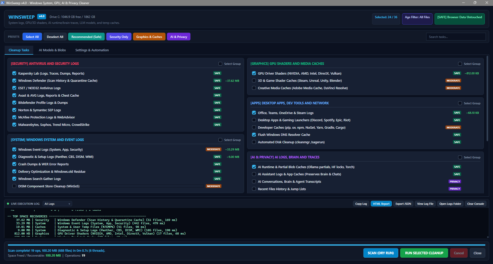

# WinSweep

A lightweight, zero-dependency Windows system, GPU shader, AI storage, and privacy cleanup suite built with PowerShell and WPF.

WinSweep provides a dark-themed interactive GUI (and headless `-NoGui` CLI mode) to scan and clean Windows system logs, antivirus logs, temporary caches, GPU & 3D engine shader caches, AI runtime/partial blobs, LLM models, AI conversations/brain transcripts, and Windows activity traces — **while strictly leaving all browser data (caches, passwords, and history) untouched.**



## What's New in v4.0

- **Dry Run / Scan Mode**: Preview exact recoverable space per task (`~MB` / `~GB`) before deleting anything.
- **Async Background Execution + Cancel**: Runs scans and cleanups in a background PowerShell Runspace with a live progress bar and Cancel support.
- **AI Models & Blobs Inspector**: Dedicated tab to scan and selectively delete multi-GB models/blobs from **Ollama** (including orphaned/partial blobs), **Hugging Face Hub**, **LM Studio**, **GPT4All**, **Jan AI**, and custom folders (e.g. ComfyUI).
- **Expanded Graphics & 3D Caches**: NVIDIA (`DXCache`, `GLCache`, `NV_Cache`, `OptixCache`, `Downloader`), AMD (`DxCache`, `GLCache`, `VkCache`, `DxcCache`, `CN`), Intel, DirectX Shader Cache, Vulkan, Steam `shadercache`, Unreal DDC, Unity, Blender, Adobe Media Cache, and DaVinci Resolve `CacheClip`.
- **Granular AI Logs vs. Brain/Transcripts**: Clean AI logs & caches safely without touching conversations, or selectively purge transcripts across Antigravity (`brain`), Claude Code, OpenAI Codex CLI, Windsurf, Cursor, Cline, Roo Code, Copilot `chatSessions`, Aider, Continue, LM Studio, Jan, and Zed (while protecting `.gemini` skills/plugins/rules).
- **Settings & Automation**: Persistent `config.json`, custom exclusion rules, custom cleanup folders, file age filter (`OlderThanDays`), optional pre-cleanup System Restore Point, log retention pruning, JSON report export, and Windows Task Scheduler integration.
- **Headless CLI Mode (`-NoGui`)**: Automate via `-Preset`, `-DryRun`, `-Silent`, and `-OlderThanDays`.

## Cleanup Categories

- **Security**: Kaspersky, Windows Defender, ESET/NOD32, Avast/AVG, Bitdefender, Norton/Symantec SEP, McAfee, Malwarebytes, Sophos, Trend Micro, F-Secure, Comodo, Panda, G Data, Webroot, CrowdStrike.
- **System**: Windows Event Logs, Diagnostic & Setup Logs (`Panther`, `CBS`, `DISM`, `WMI`, `SleepStudy`, `LiveKernelReports`), Crash Dumps & WER, Delivery Optimization & `Windows.old`, Windows Search Gather Logs, DISM Component Store (`StartComponentCleanup`).
- **Caches**: System/User `%TEMP%`, Prefetch, Windows Update Download Cache, Recycle Bin, Thumbnail/Icon DBs, Font Cache, Installer Patch Cache, Microsoft Store `LocalCache`, Custom Cleanup Folders.
- **Graphics**: GPU Driver Shaders (NVIDIA, AMD, Intel, DirectX, Vulkan), 3D & Game Engine Shaders (Steam, Unreal, Unity, Blender), Creative Media Caches (Adobe, DaVinci Resolve).
- **Apps**: Office/Teams/OneDrive/Steam Logs, Desktop & Gaming Launchers (Discord, Spotify, Slack, OBS, Epic, Riot, Battle.net), Developer Caches (`pip`, `uv`, `npm`, `NuGet`, `Yarn`, `Gradle`, `Cargo`, Java, VS), DNS Cache, `cleanmgr`.
- **AI & Privacy**: AI Runtime & Partial Blob Caches (`*-partial`, HF `.locks`/`.incomplete`, PyTorch, Whisper, ONNX), AI Logs & App Caches, AI Conversations/Brain/Transcripts, Explorer Recent/Jump Lists, Windows Activity Traces (`ConsoleHost_history.txt`, `RunMRU`, `TypedPaths`, `UserAssist`, `ConnectedDevicesPlatform`, Clipboard).

## Usage

### Interactive GUI
Double-click **`WinSweep.bat`** (automatically requests Administrator privileges and launches in STA mode).

### Headless CLI Mode
Run from an elevated PowerShell prompt:
```powershell
# Preview (Dry Run) using the Recommended preset
.\WinSweep.ps1 -NoGui -Preset Recommended -DryRun

# Silent cleanup of files older than 7 days
.\WinSweep.ps1 -NoGui -Preset Caches -OlderThanDays 7 -Silent
```
Available `-Preset` values: `Recommended`, `All`, `Security`, `System`, `Caches`, `Graphics`, `Apps`, `AI`, `Privacy`.

### Running Tests
```powershell
powershell.exe -NoProfile -ExecutionPolicy Bypass -STA -File .\tests\Run-Tests.ps1
```

## Project Structure

- `WinSweep.bat` — Auto-elevating Batch launcher (forwards CLI flags)
- `WinSweep.ps1` — Main entry point (CLI & GUI)
- `src/Core/` — `Config.ps1`, `Logger.ps1`, `Cleaner.ps1`, `ModelScanner.ps1`
- `src/Tasks/TaskRegistry.ps1` — All cleanup task definitions
- `src/UI/` — `MainWindow.xaml` and `MainWindow.ps1`
- `tests/Run-Tests.ps1` — Automated syntax, XAML, safety guard, sandbox, and scanner tests
- `Logs/` — Timestamped execution logs & exported JSON reports (ignored by Git)
